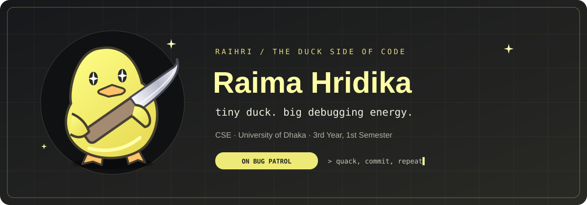

◆ &nbsp; C U R I O S I T Y &nbsp; · &nbsp; C O D E &nbsp; · &nbsp; C R A F T &nbsp; ◆

THE PERSONAL COLLECTION OF RAIMA HRIDIKA

 

## Ⅰ &nbsp; Behind the sparkle

Hello! I'm **Raima**, a Computer Science and Engineering student at the **University of Dhaka**, currently in **3rd Year, 1st Semester**. This is my corner of GitHub — a collection of projects, hackathon work, and lessons learned along the way.

<table>
<tr>
<td width="50%" valign="top">

#### ◇ EDUCATION
**University of Dhaka**  
Computer Science & Engineering  
3rd Year · 1st Semester

</td>
<td width="50%" valign="top">

#### ◇ THE ATELIER
Academic projects & coursework  
Hackathon ideas & collaboration  
Learning through hands-on work

</td>
</tr>
</table>

 

## Ⅱ &nbsp; The signature collection

<table>
<tr>
<td width="50%" valign="top" align="center">

01 · THE COLLECTION

### ◇ DUCONQUER

</td>
<td width="50%" valign="top" align="center">

02 · THE COLLECTION

### ◇ CLOUDCARE

</td>
</tr>
</table>

<a href="https://github.com/Raihri?tab=repositories&type=public"><b>See what else I've been building ↗</b></a>

 

◆ &nbsp; **Thoughtfully made. Always becoming.** &nbsp; ◆

