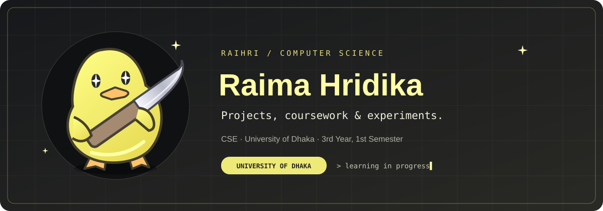
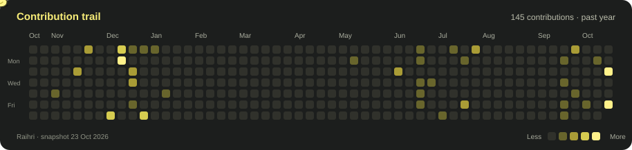

## About

I'm **Raima Hridika**, a Computer Science and Engineering student at the **University of Dhaka**, currently in **3rd Year, 1st Semester**.

I share academic projects, hackathon work, coursework, and experiments here.

## Selected projects

<table>
<tr>
<td width="50%" valign="top">

01 &nbsp; / &nbsp; PROJECT

### DUCONQUER

</td>
<td width="50%" valign="top">

02 &nbsp; / &nbsp; PROJECT

### CLOUDCARE

</td>
</tr>
</table>

<a href="https://github.com/Raihri?tab=repositories&amp;type=public"><b>Browse all repositories ↗</b></a>

 

## Contribution trail

 

---

### Get in touch

[raimahridika2@gmail.com](mailto:raimahridika2@gmail.com)

